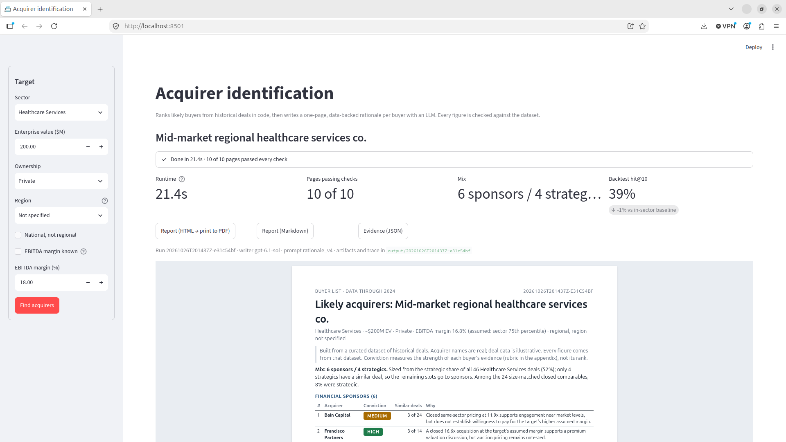

# Acquirer identification engine

Given a target company and a CSV of precedent M&A deals, rank the 10 most likely acquirers and write a one-page, data-backed rationale for each.

- **Default target (the brief):** Healthcare Services, ~$200M EV, mid-market, private, regional, strong EBITDA margins.
- **Output:** a print-ready report with a summary page, one A4 page per buyer (overview, strategic fit, precedents, valuation, risk flags, conviction) and an appendix. See [`samples/report.html`](samples/report.html) (open it in a browser and print to PDF) or [`samples/report.md`](samples/report.md).
- **Runtime and cost:** about 16s end to end and about $0.17 per run; 0.1s and $0 when served from cache.

> **Demo video (4½ min):** [Watch on Google Drive](https://drive.google.com/file/d/14IgfSilyo1kVQ7LkI73xAuBbRUX_idkp/view). The prototype needs a paid OpenAI key, so the video shows a full run. To see the output without a key, open [`samples/report.html`](samples/report.html).

[](https://drive.google.com/file/d/14IgfSilyo1kVQ7LkI73xAuBbRUX_idkp/view)

## Contents

1. [Run it](#run-it)
2. [How it works](#how-it-works)
3. [Evaluation](#evaluation)
4. [Assumptions](#assumptions)
5. [Non-determinism](#non-determinism)
6. [Known limitations](#known-limitations)
7. [With more time](#with-more-time)
8. [Repository map](#repository-map)

## Run it

You need Python 3.12, [uv](https://docs.astral.sh/uv/) (`mise.toml` pins both) and an OpenAI API key for the writing step.

```bash
cp /path/to/ma_transactions_500.csv data/   # the dataset is not committed
make install                                # pinned dependencies
export OPENAI_API_KEY=...
make run      # -> output/<run_id>/report.html, report.md, trace.jsonl, run.json
make app      # or the Streamlit app at http://localhost:8501
```

| Command | What it does | Needs key |
|---|---|---|
| `make run` | Full pipeline, writes the report, trace and run metadata to `output/<run_id>/` | yes |
| `make app` | Target form, live progress, the report and downloads. Without a key it ranks only | for writing |
| `make rank` | Ranking and evidence only, printed as a table | no |
| `make eval` | Ranking backtest (golden set 1) | no |
| `make check` | Lint and 67 offline tests (no network, no key) | no |

**Other targets:** `uv run acquirer-id run --sector Dental --size 60 --region Southeast` (also `--ownership`, `--margin`, `--national`, `--config your.yaml`, `--csv path/to.csv`). Nothing about the brief's target is hardcoded.

The app reads the key from `OPENAI_API_KEY`, or from `.streamlit/secrets.toml` (gitignored). The key is never logged or traced.

## How it works

A **fixed workflow, not an agent**. Code ranks the acquirers and computes every number. The LLM only writes, from a per-acquirer evidence pack, and every page is checked against that pack before it's shown.

```
CSV ─▶ load + validate ─▶ rank (code) ─▶ evidence packs ─▶ write (LLM, ×10 parallel) ─▶ check ─▶ report
        data.py            ranking.py     evidence.py       rationale.py + llm.py        rationale.py
```

**Why this shape:** the banker's ask is two problems. *Who* is ranking over a table, where numbers must tie out. *Why* is writing, which is where an LLM earns its place. One prompt over the whole CSV would have the model counting and taking medians over 500 rows, which it does unreliably and in a way nobody can check. An agent adds nothing when the steps are known in advance.

### Using the CSV

- **Two buyer populations.** 15 PE sponsors buy across many sectors, and 92 strategics mostly stay in one. The design follows that split.
- **Scoring:** relevant activity (sector, size, recency, outcome), focus, size fit against the buyer's own history, recency and close rate. Thin histories are shrunk toward their type's average, so one lucky deal can't top the list.
- **Adjacent sectors are computed, not assumed:** Physician Groups qualifies for Healthcare Services and Health IT does not. Adjacency applies to sponsors only.
- **The sponsor/strategic mix comes from the data** (the sector's strategic share), with a labelled minimum per type.
- **No padding:** a buyer is listed only with at least one similar deal. Here that gives 6 sponsors and 4 strategics, and the summary page says why.
- **Conviction** follows a written rubric and is capped for thin evidence. Both rules are enforced in code.

### Prompt design

The prompt is a versioned file, [`prompts/rationale_v4.md`](prompts/rationale_v4.md); v1-v3 are kept for comparison. Each call sees only the target, the market comps, the mix rationale and that acquirer's evidence pack (precedents with deal IDs, its multiples, risk signals). The output is structured (Pydantic) into the brief's six sections. Key rules:

- Only facts and numbers from the input, with no outside knowledge about the acquirers.
- No median over fewer than 5 deals; the individual values are given instead.
- A shared conviction rubric, so pages written independently stay comparable.
- At least 2 risks, each tied to a named signal; non-closed deals described as such.
- Evidence-first headlines, banned boilerplate, about 300 words per page.

Each version came from reading outputs and measuring the failure, not from guessing (see [Evaluation](#evaluation)).

### Guardrails and tracing

- **Checks after every call:** ungrounded numbers or deal IDs, off-rubric conviction, missing risks, boilerplate, jargon, page length. A failing page is shown with a ⚠ and a review note, never dropped silently.
- **Failure handling:** 32s timeout and a retry, then a fallback model (`gpt-5.6-terra`). If both fail, the page shows the raw evidence instead of crashing the report.
- **Tracing:** every call writes a JSONL span (OpenTelemetry-style field names: model, prompt version, tokens, cost, latency, input, output, issues). Eval results link to span IDs.

## Evaluation

The brief doesn't require evals. Two golden sets back the claims above.

**Ranking: does it find the real buyer?** Each 2022-24 deal is replayed using only earlier data (142 cases; dev is 2022, holdout is 2023-24, run once).

| Ranker | Dev hit@10 | Holdout hit@10 | Holdout MRR |
|---|---|---|---|
| **Shipped scorer** | **39%** | **39%** | **0.14** |
| Baseline: 10 most active buyers in the sector | 41% | 39% | 0.10 |
| Baseline: 10 most active buyers overall | 36% | 46% | 0.11 |

**Honest reading:** the ranking ties naive baselines on hit rate and ranks the real buyer higher when it finds it. That's a ceiling in this data: which sponsor buys a deal is statistically random here, and sponsors are most of the buyers. The ranking's value is the explanation behind each name, the mix and calibrated conviction.

**Rationales: is each page accurate and specific?** 13 frozen hard cases, checked in code. v1 passed every factual check yet read as a template, so checks were added to measure that, and v2 took the pass rate from 0% to 100%. The shipped v4 passes 100%. The cheapest model tested invented a figure and a deal ID, which is why it isn't the fallback.

## Assumptions

- **"Healthcare Services"** means the CSV's own sector, not the industry umbrella.
- **"Strong EBITDA margins"** is the sector's 75th percentile in the CSV, 16.8%.
- **"Regional"** has no named region in the brief, so region is an optional setting.
- **The data is illustrative:** acquirer names are real, but the deals aren't facts about those firms, and the data ends in 2024. Known status changes (Steward's bankruptcy, Atrium merged into Advocate) are flagged as unverified.
- **Data quirks:** `sub_sector` always equals `sector`, so it's ignored. There's no acquirer-size field, so size is described from deal activity.

## Non-determinism

LLM text varies between runs, so identical output isn't promised. Instead:

1. **Every number is deterministic.** Ranking, comps and evidence are pure code, and the writer can't introduce a number that isn't in the pack.
2. **Responses are cached** by model, prompt version and exact input, so re-running a target returns the same pages (`--no-cache` regenerates them).
3. **Runs are reproducible:** `run.json` stores the config, a CSV hash, the prompt version and the model the API reports.
4. **Caveat:** `gpt-6.1-sol` is an undated alias, so a silent model update can't be detected.

## Known limitations

- **Ranking accuracy:** it doesn't beat naive baselines on this data, and the weights are hand-set rather than learned.
- **Thin evidence:** many strategics have a single deal, and only 2 comps match the target's margin. Pages say so and conviction is capped.
- **Grounding check:** it misses numbers written as words and correct numbers attached to the wrong claim.
- **Rationale eval:** 13 cases, one sample each, and the rubric is my rule, not banker agreement.
- **Wording:** v4 headlines lean on pricing language; that's the next prompt fix.
- **Pitch angle:** pages don't say platform vs add-on, because the data has no portfolio holdings.

## With more time

In priority order:

1. **A learned ranker** (regularized conditional logit over the same features), judged by the same backtest.
2. **An LLM judge calibrated against banker labels** for "specific, not boilerplate".
3. **Prompt v5** with contrasting examples, to break the pricing-heavy headlines.
4. **Firm stack:** a Claude provider behind the existing `ModelClient` interface, and the pipeline as a scheduled job over governed tables.

## Repository map

| Path | Contents |
|---|---|
| `src/acquirer_id/` | `data`, `ranking`, `evidence`, `rationale` (writer and checks), `llm` (provider interface), `tracing`, `report` / `report_html`, `runner` (shared by `cli` and `app`), `backtest`, `rationale_eval` |
| `prompts/` | Versioned prompts (v1-v4) |
| `configs/` | The default target and the entity notes |
| `evals/golden/` | Frozen golden sets (IDs and targets only) |
| `samples/` | Sample report for the default target |

**Note on stack:** the firm's LLM stack is Claude. This build uses OpenAI only because that was the key available. Switching provider is one class plus a config change.
